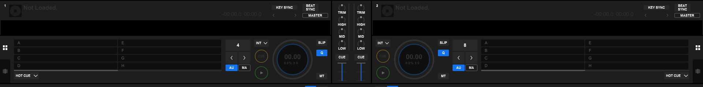

# rekordbox under Wine

[](https://github.com/MrNorm/rekordbox-wine/actions/workflows/build.yml)
[](https://github.com/MrNorm/rekordbox-wine/releases/latest)
[](LICENSE)

Runs **rekordbox 7.2.x** on Linux with a **Pioneer DDJ-400**, including
**PC MASTER OUT** — audio to the controller and the computer's speakers at once.

Ten Wine patches and a launcher that applies and verifies them.

> **rekordbox is not included** — it is proprietary. The launcher downloads it
> from rekordbox.com for you; you sign in with your own AlphaTheta account.



Decks and mixer, rekordbox 7.2.18 on wine-staging 11.16. On stock Wine this
window paints one frame and freezes.

**Contents:** [Requirements](#requirements) · [Install](#install) ·
[Installing rekordbox](#installing-rekordbox-itself) · [DDJ-400 setup](#ddj-400-setup) ·
[USB stick and PRO DJ LINK](#usb-stick-export-and-pro-dj-link) ·
[Debian and Fedora](#debian-and-fedora) · [Troubleshooting](#troubleshooting) · [Keeping it working](#keeping-it-working) ·
[What works](#what-works) · [What is not proven](#what-is-not-proven)

## Requirements

| | |
|---|---|
| Distribution | **Arch**, **Debian trixie**, **Fedora 43**. |
| Architecture | x86_64 |
| Wine | **None needed.** The package carries its own: wine-staging **11.18** with every fix compiled in, at `/usr/lib/rekordbox-wine/wine`. Your system Wine is not used or touched, and upgrading it cannot break rekordbox. |
| GPU | Tested on Intel Iris Xe. Nvidia and AMD untested here. |
| Controller | DDJ-400 for the controller and PC MASTER OUT claims. Other hardware untested. |
| Player | XDJ-XZ — reads back an exported stick in USB mode, and streams over PRO DJ LINK on the router LAN (T02, T15). No other player tested. |
| Root needed | Only to install the package and replug/reboot for the udev and module rules. |

## Install

Arch, one line:

```sh
curl -fsSL https://raw.githubusercontent.com/MrNorm/rekordbox-wine/master/bin/install.sh | bash
```

Downloads the latest release, checks it against the release's `SHA256SUMS`,
and installs it.

Then:

```sh
rekordbox-wine --install     # downloads rekordbox and installs it
rekordbox-wine               # launch
```

Prefer to read it first? `bin/install.sh` is in this repository — download it,
read it, run it.

### Build from source

Compiles the whole pinned Wine with the patches: 20–60 minutes depending on the
CPU, and about 4 GB of disk while building.

```sh
git clone https://github.com/MrNorm/rekordbox-wine.git
cd rekordbox-wine/packaging
makepkg -si
```

The package version records the commit it was built from
(`0.3.0.r<commits>.g<short-sha>`). To update: `git pull`, then `makepkg -si`.

`paru` installs from AUR or from package *files*, not from a local PKGBUILD
directory, so hand it the result: `paru -U rekordbox-wine-git-*.pkg.tar.zst`.

**Not on the AUR.** AUR pushes have been blocked over malware injection; this
project distributes from GitHub instead.

### Debian and Fedora

No prebuilt packages yet. Build them; like the Arch package, each compiles its
own Wine, so no Wine from the distribution or from WineHQ is needed:

```sh
git clone https://github.com/MrNorm/rekordbox-wine.git
cd rekordbox-wine
packaging/build-deb.sh        # Debian/Ubuntu  -> ../rekordbox-wine_*.deb
packaging/build-rpm.sh        # Fedora         -> ~/rpmbuild/RPMS/x86_64/*.rpm
```

The build needs a mingw-w64 cross compiler (`gcc-mingw-w64-x86-64` and
`gcc-mingw-w64-i686`; Fedora `mingw64-gcc` and `mingw32-gcc`). Both packages are
built, checked for every patch marker inside the package and installed on their
own distributions by [`packages.yml`](.github/workflows/packages.yml).

## Installing rekordbox itself

Neither command needs root. The rekordbox installer shows one language dialog —
press Return.

| command | behaviour |
|---|---|
| `rekordbox-wine --install` | asks which version, then installs |
| `rekordbox-wine --install --latest` | newest, no questions |
| `rekordbox-wine --install <file.exe>` | uses an installer you already have |
| `rekordbox-wine --fetch [dir]` | downloads only |

With no terminal — a script, CI, a hook — `--install` never prompts and takes
the newest.

The version prompt offers the current release plus any installer already on the
machine (download cache, working directory, `artifacts/`):

```
Which version?
  1) 7.2.18  (current release — download)
  2) 7.2.17  (already here — artifacts/Install_rekordbox_x64_7_2_17.exe)
```

**Only the current release is downloadable.** AlphaTheta publishes one installer
link; there is no archive page, and older CDN paths return 403. Anything else in
the list is a file already on your disk.

`bin/fetch-rekordbox.sh --list` shows what is available without downloading.

The launcher runs on every start and repairs drift: it checks every fix in its
Wine, removes DLL overrides older versions left in the prefix, applies the audio
settings PC MASTER OUT needs, and corrects Wine's own menu entry.

`rekordbox-wine --check` reports all of it and changes nothing.

## DDJ-400 setup

Two one-off steps that need root or physical access:

- **Replug the controller**, so the installed udev rule applies.
- **Reboot, or `sudo modprobe -r snd_seq_dummy`.** Without this rekordbox binds
  an ALSA loopback instead of the controller.

`rekordbox-wine --check` reports whether either is outstanding.

## USB stick export and PRO DJ LINK

**Stick.** Two things, both per machine and neither done by the launcher yet.

Read access to the raw block node, from a udev rule. Wine's `mountmgr` opens
`/dev/sdX1` to read the filesystem, and reports the stick as NTFS when the open
fails:

```text
SUBSYSTEM=="block", KERNEL=="sd*", ENV{ID_BUS}=="usb", TAG+="uaccess"
```

Number it below 73, where systemd acts on the tag.

A drive letter in the prefix, with the raw node next to it — the letter alone is
not enough, because the filesystem type and the device are both read through the
node. The letter is arbitrary:

```bash
ln -s /run/media/you/DATA  "$WINEPREFIX/dosdevices/e:"   # the DOS drive
ln -s /dev/sda1            "$WINEPREFIX/dosdevices/e::"  # the raw node it is read from
```

**PRO DJ LINK.** Put the player on the router LAN and allow the LAN subnet
inbound; the player connects to the computer, not the other way round:

```bash
firewall-cmd --zone=public --add-rich-rule='rule family="ipv4" source address="192.168.0.0/24" accept' --permanent
firewall-cmd --reload
# undo: firewall-cmd --zone=public --remove-rich-rule='rule family="ipv4" source address="192.168.0.0/24" accept' --permanent && firewall-cmd --reload
```

**Do not cable the player's USB port to the PC at the same time.** That port is
a USB network bridge, and it adds a second interface on the player's subnet,
which breaks streaming. `ip -br addr` should show **one** interface on your LAN.

## Troubleshooting

Run `rekordbox-wine --check` first. It names the problem in most cases.

| symptom | cause | fix |
|---|---|---|
| `Not launching` and a list of blockers | The package is damaged, or a system library its Wine loads was removed | Reinstall the package; see [System updates](#system-updates) |
| Starts, one frame, then frozen | Started through Wine's own menu entry, bypassing the patches | Use `rekordbox-wine`, or the entry marked *(via rekordbox-wine)* |
| Two menu entries, one broken | Wine regenerates its entry on install | The launcher corrects it on every start |
| Controller absent, or MIDI binds to something else | udev rule or `snd_seq_dummy` | [DDJ-400 setup](#ddj-400-setup) |
| Controller absent after a kernel update | The running kernel's modules were deleted by the upgrade | Reboot. `kernel-modules-hook` prevents it |
| Sample-rate list empty in Preferences | Audio driver is `winepulse`, which has no exclusive mode | `--check` reports the driver; it must be `alsa` |
| A sound device vanishes from PipeWire mid-session | WirePlumber 0.5.15 crashes in its own ALSA error handler | `systemctl --user restart wireplumber` |
| PC MASTER OUT stalls | `WasapiPolling` / `AudioBufferSize` | The launcher seeds both; `--check` verifies them |
| Stick listed, but "formatted with an unsupported file system" | The filesystem type is read from the raw node; without read access it is misreported as NTFS | [USB stick export](#usb-stick-export-and-pro-dj-link) |
| PRO DJ LINK: player never sees the computer | Firewall, or the player's USB port cabled to the PC | [PRO DJ LINK](#usb-stick-export-and-pro-dj-link) |

## Keeping it working

### rekordbox updates

Nothing to do. rekordbox updates itself inside the prefix and the launcher starts
the newest version it finds. No Wine component is tied to a rekordbox version.

The launcher names the version it starts:

```
ok    rekordbox 7.2.18 — measured; see docs/GOLD-STATUS.md
warn  rekordbox 7.3.0 has not been measured by this project
```

It warns and starts. Measured versions are listed in
[`upstream/supported-rekordbox.txt`](upstream/supported-rekordbox.txt).

### System updates

**Wine updates: nothing to do.** rekordbox runs on the Wine inside this package,
never on your system's, so `pacman -Syu` moving wine-staging changes nothing.
Until 0.3.0 the package patched the system Wine, and every Wine upgrade broke
rekordbox until the patches were rebuilt.

**Kernel updates: reboot before DJing.** Arch deletes the running kernel's
modules when it upgrades the kernel, so a controller plugged in before the
reboot gets no MIDI driver. The package loads `snd_seq_midi` and `snd_usb_audio`
at boot so they are already in memory, and
[`kernel-modules-hook`](https://archlinux.org/packages/extra/any/kernel-modules-hook/)
keeps the old modules until you reboot:

```sh
sudo pacman -S kernel-modules-hook
```

**Library updates.** The bundled Wine still loads a few system libraries
(GnuTLS, OpenGL, X11, FreeType). After every pacman transaction a hook checks
they still resolve, and prints what is wrong if one does not. It is silent
otherwise. The launcher runs the same check on every start.

The Wine version inside the package is recorded in
[`upstream/wine-runtime.conf`](upstream/wine-runtime.conf). Moving it is a
deliberate, measured step; measured versions are in
[`upstream/patches/supported-wine.txt`](upstream/patches/supported-wine.txt).

## What works

Every claim has a run id in [`docs/GOLD-STATUS.md`](docs/GOLD-STATUS.md).

- Renders and repaints. Stock Wine paints one frame and freezes.
- Library, waveforms, analysis, two decks at 1.00× real time.
- DDJ-400 exclusive-mode audio at 44100 Hz; jog wheels and LEDs.
- PC MASTER OUT with zero stream teardowns over 465 s.
- File menu and the view-mode selector that gates EXPORT mode.
- USB export, `export.pdb` checked outside Wine by `bin/pdbcheck.py` — and the
  stick read back by a real XDJ-XZ in USB mode, waveforms, BPM and key on both
  decks.
- PRO DJ LINK to an XDJ-XZ over the router LAN — the player browses the host's
  library and plays a track (T15).

Measured on wine-staging 11.15 with rekordbox 7.2.17/7.2.18. On 11.16, "launches
and repaints", the XDJ-XZ USB readback, and PRO DJ LINK over the router LAN have
been re-measured (2026-09-12).

## What is not proven

- **`bin/pdbcheck.py` checks `export.pdb` structurally** — page size, tables,
  ranges. The XDJ-XZ reading the stick (T02) is the evidence that a real player
  accepts it; it is not a check of every field in the database.
- **PRO DJ LINK has been proven from the player side only** — a real XDJ-XZ
  browsing and playing from this host (T15).
- **No full DDJ-400 performance pass** — pad modes, FX, filters, crossfader
  curve, headphone cue, hot cues.
- Latency is 512 samples (11.6 ms), the same as a DDJ-400 on Windows. Lower costs
  about one stream teardown every 330 s, because `AvSetMmThreadCharacteristics`
  is a stub in Wine.

## System impact

The package installs its own Wine in `/usr/lib/rekordbox-wine/wine` (about
1 GB). It does not use, replace or modify your system Wine, and other Wine
applications never see the patches. It also installs a udev rule for the
controller, a module blacklist for `snd_seq_dummy`, modules to load at boot, and
a pacman hook that only checks.

```sh
/usr/share/rekordbox-wine/bin/verifyloaded.sh          # what rekordbox mapped
/usr/share/rekordbox-wine/bin/verifyloaded.sh <pid>    # any other Wine app
```

Reads `/proc/<pid>/maps`, so it reports what a process loaded rather than what is
on disk.

To remove: uninstall the package and delete `~/.local/share/rekordbox-wine`.

## Wine defects found

Twelve, ten fixed. Patches in [`upstream/patches/`](upstream/patches/).

| # | component | defect |
|---|---|---|
| 1 | `dxgi` | `IDXGIOutput::WaitForVBlank` unimplemented — any JUCE 8 application paints one frame and freezes |
| 2 | `mmdevapi` | event-driven exclusive streams refused outright — no DJ controller usable |
| 3 | `winealsa` | exclusive-mode event signalled with no period free — 343 buffer refusals in 344 periods |
| 4 | `winealsa` | SysEx split across two USB transfers — the DDJ-400 never authenticates |
| 5 | `winex11` | popup menus handed to the window manager, which places them offscreen — no File menu, no EXPORT mode |
| 6 | `mountmgr` | removable drive with unknown media type reported as no media |
| 7 | `mountmgr` | `StorageDeviceProperty` faked: every device claims fixed media on a SCSI bus |
| 8 | `setupapi` | `SPDRP_PHYSICAL_DEVICE_OBJECT_NAME` is a NULL placeholder — a device cannot be matched to a drive letter |
| 9 | `mountmgr` | no `STORAGE\Volume` device node written, so SetupAPI enumerates no volumes |
| 10 | `wineusb` | no `\\.\HCDn` device object, so rekordbox's USB validation fails and it discards the controller |
| 11 | `avrt` | `AvSetMmThreadCharacteristics` is a stub — **won't fix**: granting real-time priority is fatal while the audio thread polls |
| 12 | `mmdevapi` | `RegisterAudioSessionNotification` returns `S_OK` and never calls back — **reported** |

One defect was ours: patch 2 widened the exclusive buffer to four periods,
rekordbox read that back via `GetBufferSize()` and used it as its audio block
size. Written up in
[`upstream/reports/NOTES-mmdevapi-buffer-widening.md`](upstream/reports/NOTES-mmdevapi-buffer-widening.md).

## CI

- **`build.yml`** — builds the package, with its pinned Wine, per push and
  weekly, and verifies the patch markers inside the built package.
- **`wine-watch.yml`** — weekly; opens an issue when Arch has a newer
  wine-staging than the pinned one. Users are not affected by that; it is a
  prompt to consider moving the pin.
- **`release.yml`** — publishes a package per `v*` tag, Wine version in the asset
  name.
- **`aur.yml`** — manual dispatch, gated on a secret.

The rekordbox axis cannot be tested in CI: proprietary, 660 MB installer behind a
JavaScript download page, sign-in needs a real account.

## Documentation status

This repository is the only thing published. The WineHQ Bugzilla reports, the
WirePlumber report and the two AppDB submissions are written and **unfiled** —
[`docs/PUBLISHING.md`](docs/PUBLISHING.md) lists what each needs.

The `WaitForVBlank` report matters most: without that fix no JUCE 8 application
paints a second frame.

## Investigation

| | |
|---|---|
| [`docs/investigation/STATE.md`](docs/investigation/STATE.md) | current hypothesis and next action |
| [`docs/investigation/JOURNAL.md`](docs/investigation/JOURNAL.md) | append-only timeline |
| [`docs/investigation/THEMES/`](docs/investigation/THEMES/) | one file per theme, each with root-cause analysis |
| [`docs/GOLD-STATUS.md`](docs/GOLD-STATUS.md) | every capability, its state, the evidence |
| [`docs/REMAINING-STEPS-TO-GOLD.md`](docs/REMAINING-STEPS-TO-GOLD.md) | what is left and who can do it |
| [`docs/PACKAGE.md`](docs/PACKAGE.md) | what the package installs and why |
| [`docs/REGRESSION.md`](docs/REGRESSION.md) | tests that must pass before a release |

`bin/rbw` is the harness; run it with no arguments for the commands.

The hardest bug was broken open with **LBR call-graph profiling**
(`perf record -e cycles:u --call-graph lbr`, which needs no unwind information)
plus **hardware execute breakpoints** (`perf record -e mem:<addr>:x`) to count
how often one instruction in a stripped 100 MB binary ran. See
[`docs/investigation/THEMES/`](docs/investigation/THEMES/) T10.

## Licence

Wine patches LGPL-2.1-or-later, matching Wine. Harness and launcher scripts MIT.
